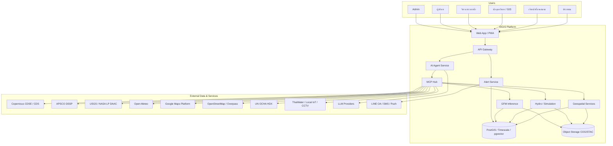
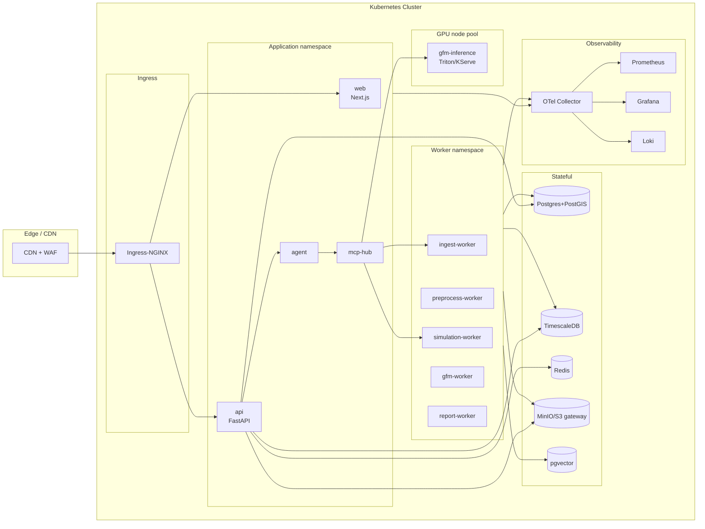
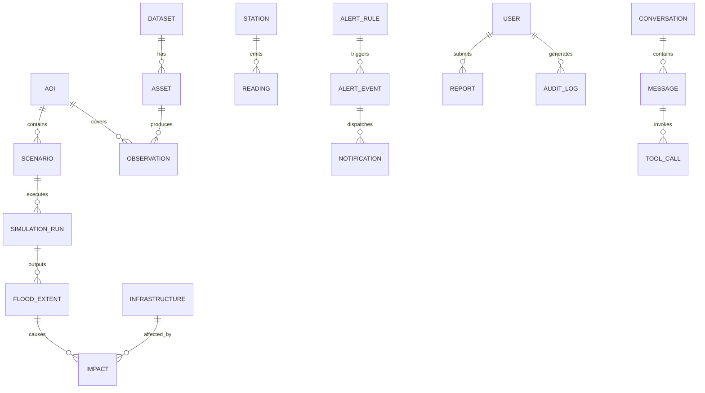
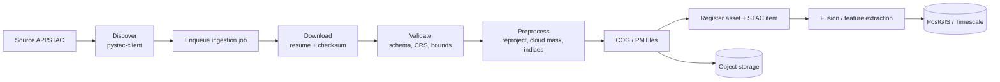
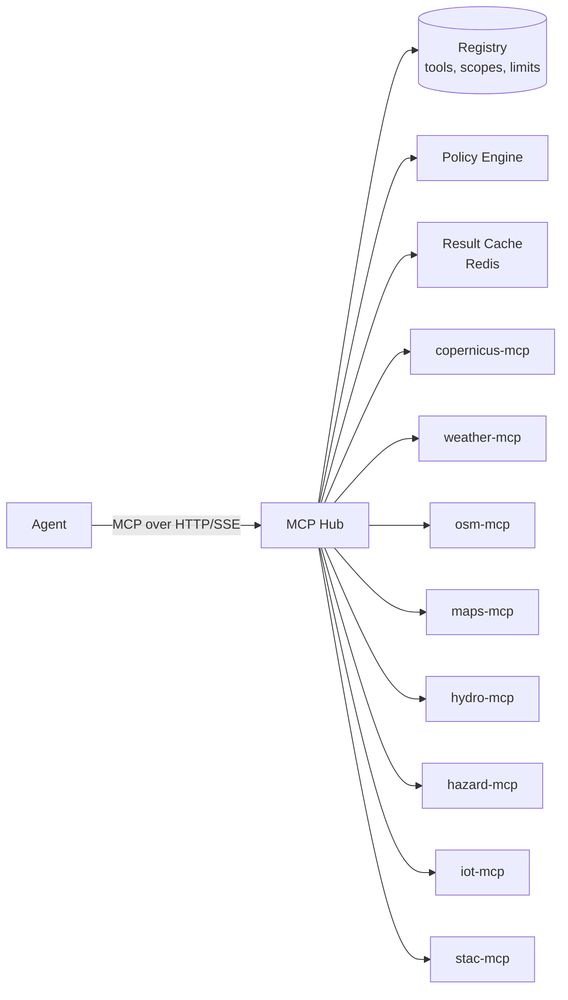
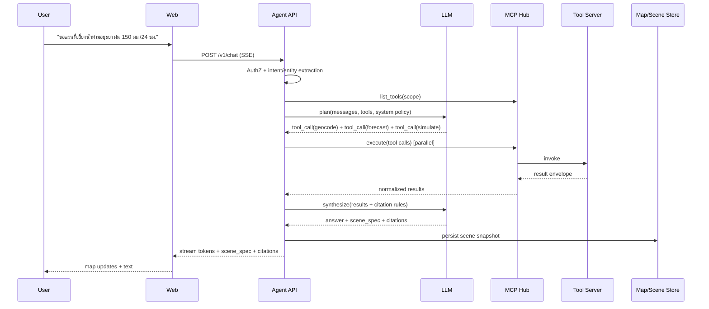
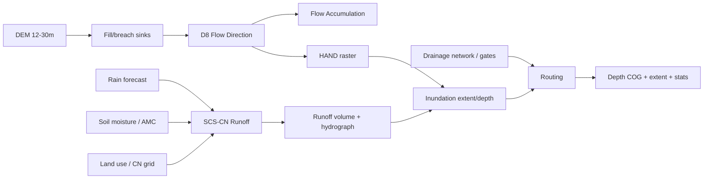
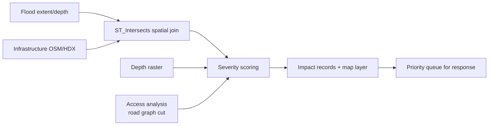

# AIGIS — Technical Specification
### AI-driven Integrated Geospatial & Inundation System
**เอกสารข้อกำหนดทางเทคนิค (Technical Specification) ฉบับที่ 1.0**

| รายการ | รายละเอียด |
| :--- | :--- |
| ชื่อระบบ | AIGIS (AI-driven Integrated Geospatial & Inundation System) |
| เวอร์ชันเอกสาร | 1.0 (Baseline) |
| วันที่ | 2 พฤศจิกายน 2026 |
| สถานะ | Draft for Technical Review |
| อ้างอิง | `README.md`, `Requirement.md` (SRS), `AIGIS System Architecture.png` |
| ขอบเขต | สถาปัตยกรรมซอฟต์แวร์, สัญญา API/MCP, โมเดลข้อมูล, pipeline ข้อมูลภูมิสารสนเทศ, การออกแบบ AI Agent, NFR, ความมั่นคงปลอดภัย, การทดสอบ และแผนนำส่ง |

---

## สารบัญ

1. [บทนำและวิธีการวิเคราะห์ความต้องการ](#1-บทนำและวิธีการวิเคราะห์ความต้องการ)
2. [สรุปผลการวิเคราะห์ความต้องการ](#2-สรุปผลการวิเคราะห์ความต้องการ)
3. [สถาปัตยกรรมระบบเป้าหมาย](#3-สถาปัตยกรรมระบบเป้าหมาย)
4. [การแบ่งองค์ประกอบและความรับผิดชอบ](#4-การแบ่งองค์ประกอบและความรับผิดชอบ)
5. [สถาปัตยกรรมข้อมูลและโมเดลข้อมูล](#5-สถาปัตยกรรมข้อมูลและโมเดลข้อมูล)
6. [Data Ingestion & Geospatial Pipeline](#6-data-ingestion--geospatial-pipeline)
7. [MCP Server Specification](#7-mcp-server-specification)
8. [AI Agent & Orchestration Design](#8-ai-agent--orchestration-design)
9. [Hydrological & Flood Modeling Engine](#9-hydrological--flood-modeling-engine)
10. [GFM Flood Segmentation Pipeline](#10-gfm-flood-segmentation-pipeline)
11. [Impact Analysis, Drainage Optimization & Routing](#11-impact-analysis-drainage-optimization--routing)
12. [API Specification](#12-api-specification)
13. [Realtime, Alerting & Notification](#13-realtime-alerting--notification)
14. [Frontend & Dashboard Architecture](#14-frontend--dashboard-architecture)
15. [Non-Functional Requirements Implementation](#15-non-functional-requirements-implementation)
16. [Security, Privacy & Governance](#16-security-privacy--governance)
17. [Observability & SLO](#17-observability--slo)
18. [Testing Strategy](#18-testing-strategy)
19. [Deployment, CI/CD & Environments](#19-deployment-cicd--environments)
20. [ความเสี่ยงและมาตรการลดความเสี่ยง](#20-ความเสี่ยงและมาตรการลดความเสี่ยง)
21. [Traceability Matrix](#21-traceability-matrix)
22. [แผนนำส่งตาม Roadmap](#22-แผนนำส่งตาม-roadmap)
23. [ภาคผนวก](#23-ภาคผนวก)

---

## 1. บทนำและวิธีการวิเคราะห์ความต้องการ

### 1.1 วัตถุประสงค์ของเอกสาร
เอกสารนี้แปลง **Software Requirement Specification (SRS)** ของ AIGIS ให้เป็นข้อกำหนดทางเทคนิคที่ทีมพัฒนาสามารถลงมือimplementได้ โดยระบุ:

- องค์ประกอบซอฟต์แวร์ (components) และขอบเขตความรับผิดชอบ
- สัญญาการเชื่อมต่อ (API contract, MCP tool contract, event schema)
- โครงสร้างข้อมูลและที่เก็บข้อมูล
- อัลกอริทึม/โมเดลที่ใช้ในแต่ละขั้นตอน พร้อมพารามิเตอร์เริ่มต้น
- ข้อกำหนดที่ไม่ใช่เชิงฟังก์ชันในรูปแบบที่วัดผลได้
- แนวทางความมั่นคงปลอดภัย การทดสอบ และการนำส่ง

### 1.2 วิธีการวิเคราะห์
การวิเคราะห์ดำเนินการ 5 ขั้น:

1. **Requirement Extraction** — ดึง FR/NFR/ผู้ใช้งาน/แหล่งข้อมูล จาก `Requirement.md` และภาพสถาปัตยกรรม
2. **Domain Decomposition** — แยกโดเมนเป็น Data, AI, Geospatial Modeling, Operations, Presentation
3. **Gap & Assumption Analysis** — ระบุข้อกำหนดที่ยังกำกวม/ขาดหาย และตั้งสมมติฐานทางเทคนิค (ข้อ 2.4)
4. **Architecture Derivation** — maps แต่ละ requirement ไปยัง component และ interfaCE
5. **Verification Design** — กำหนดวิธีทดสอบและตัวชี้วัดสำหรับแต่ละ requirement

### 1.3 ขอบเขต
**In scope:** แพลตฟอร์มซอฟต์แวร์ทั้งหมด รวมถึง MCP servers, AI agent, geospatial processing, hydrological/flood modeling, GFM inference, dashboard 5 ชุด, alerting, API และ infrastructure

**Out of scope (phase แรก):** การควบคุมอุปกรณ์ประตูระบายน้ำจริงแบบ closed-loop (ระบบเป็น recommendation-only), การผลิต hardware IoT, โมเดล 3D city-scale แบบ real-time ray tracing, การรับรองทางกฎหมายของคำแนะนำ

---

## 2. สรุปผลการวิเคราะห์ความต้องการ

### 2.1 ผู้ใช้งานและบทบาท (Actors)

| Actor | บทบาทในระบบ | สิทธิ์หลัก |
| :--- | :--- | :--- |
| Public Citizen | ประชาชนทั่วไป | ดูแผนที่สาธารณะ, เช็กจุดเสี่ยง, รายงานเหตุ, รับแจ้งเตือน |
| Field Officer | เจ้าหน้าที่ภาคสนาม/ปภ. | ดูข้อมูลปฏิบัติการ, อัปเดตสถานะเหตุ, ยืนยัน ground truth |
| Hydrologist | นักอุทกวิทยา/นักวิเคราะห์ GIS | รัน simulation, ปรับพารามิเตอร์โมเดล, export ข้อมูล |
| Drainage Engineer | วิศวกรชลประทาน/ผู้ควบคุมประตูน้ำ | ดูสถานะโครงข่าย, รับคำแนะนำ, บันทึกการสั่งการ (manual) |
| Executive | ผู้บริหาร/ผอ.ศูนย์สั่งการ | ดู dashboard สรุป, สั่งงานผ่าน AI, อนุมัติแผน |
| System Admin | ผู้ดูแลระบบ | จัดการผู้ใช้, config, MCP registry, audit |

> **ข้อกำหนด RBAC:** 6 roles ข้างต้น map เป็น permission set แบบ attribute-based เพิ่มเติมตามพื้นที่รับผิดชอบ (province/basin) — ดูข้อ 16.2

### 2.2 การจัดลำดับความสำคัญ (MoSCoW)

| ระดับ | รายการ |
| :--- | :--- |
| **Must** | FR-01 (Conversational AI + MCP), FR-02 (multi-source fusion), FR-03.1–03.3, FR-04.1–04.2, FR-05.1, FR-05.3, NFR-01/03/04 |
| **Should** | FR-03.4, FR-04.3, FR-04.4, FR-05.2, NFR-02 |
| **Could** | Voice command, 3D visualization, AI CCTV vision analytics, multi-tenant |
| **Won't (v1)** | Closed-loop gate actuation, automated evacuation order issuance |

### 2.3 การแปลงความต้องการเป็นความสามารถทางเทคนิค

| Requirement | ความสามารถทางเทคนิค | Component หลัก |
| :--- | :--- | :--- |
| FR-01.1 ภาษาธรรมชาติ TH/EN | Intent parsing, entity resolution (สถานที่→AOI), streaming response | Agent Service, LLM Gateway |
| FR-01.2 Tool calling อัตโนมัติ | MCP client + tool registry + policy/guardrail | Agent Service, MCP Hub |
| FR-02.1 Sentinel-1/2 | STAC search, asset download, COG conversion | Ingestion Worker, Copernicus MCP |
| FR-02.2 DEM/ถนน/ลำน้ำ | OSM Overpass, Google Maps, DEM tiling | OSM MCP, Maps MCP, Raster Service |
| FR-02.3 พยากรณ์/soil moisture | Open-Meteo + ERA5/CDS ingest, time-series store | Weather MCP, TimescaleDB |
| FR-03.1 Flow direction/accumulation | DEM conditioning + D8 + HAND | Hydro Engine (WhiteboxTools) |
| FR-03.2 Soil saturation & runoff | SCS-CN / antecedent moisture adjustment | Hydro Engine |
| FR-03.3 What-if simulation | Scenario engine + inundation model + versioning | Simulation Service |
| FR-03.4 พร่องน้ำ/ขุดลอก | Prioritization scoring, action checklist | Optimization Service |
| FR-04.1 SAR flood extent | GFM inference + postprocessing + permanent water mask | GFM Inference Service |
| FR-04.2 Infrastructure impact | Spatial overlay + criticality scoring | Impact Service |
| FR-04.3 Smart drainage | Constraint optimization (OR-Tools) | Optimization Service |
| FR-04.4 Evacuation routing | Flood-aware graph + routing API | Routing Service |
| FR-05.1 GIS dashboard | Map engine, layer catalog, scene spec | Web App, Tile Service |
| FR-05.2 Report generation | Template + headless render + PDF | Report Worker |
| FR-05.3 Alerting | Rules engine + multi-channel dispatcher | Alert Service |
| NFR-01 Performance | Cache hierarchy, COG/PMTiles, streaming, GPU pool | ทุกชั้น |
| NFR-02 Scalability | Stateless services, queue-based workers, KEDA | Platform |
| NFR-03 Interoperability | OGC API (WMS/WFS/STAC), MCP, GeoJSON | API Gateway |
| NFR-04 Security | OIDC, RBAC/ABAC, audit, signed URL | Security Layer |

### 2.4 สมมติฐานและการตีความ (Assumptions)

| ID | สมมติฐาน | ผลกระทบถ้าไม่จริง |
| :--- | :--- | :--- |
| A-01 | พื้นที่นำร่องคือลุ่มน้ำเจ้าพระยาตอนล่าง/กทม. และปริมณฑล | ต้องปรับ CRS, datum, threshold และ train GFM ใหม่ |
| A-02 | ใช้ Google Maps Platform ตามสัญญา ToS (ห้าม cache เนื้อหาแผนที่เกินข้อกำหนด) | ต้องเปลี่ยน base map เป็น OSM/MapLibre |
| A-03 | Sentinel-1 latency 6–24 ชม. ไม่ใช่ real-time วินาที | ต้องเสริมข้อมูล IoT/CCTV และ crowdsourcing |
| A-04 | DEM ความละเอียด 12–30 ม. (ALOS/SRTM) | ความแม่น inundation ลดลงในเขตเมืองแคบ |
| A-05 | ระบบให้ **คำแนะนำ** ไม่สั่งการอุปกรณ์อัตโนมัติ | ต้องมี human-in-the-loop และ audit |
| A-06 | LLM ใช้ได้ทั้ง cloud API และ on-prem (เพื่อ data residency) | ต้องมี abstraction layer + model routing |
| A-07 | ข้อมูล ERA5 มี latency ~5 วัน สำหรับ near-real-time ใช้ forecast/soil moisture จากモデルอื่น | ต้องปรับ antecedent moisture source |

### 2.5 ช่องว่างของ SRS ที่เอกสารนี้เติมเต็ม

| ช่องว่าง | ข้อกำหนดทางเทคนิคที่เพิ่ม |
| :--- | :--- |
| ไม่ระบุ latency ของข้อมูลดาวเทียม | กำหนด data freshness SLA ต่อแหล่ง + badge "ข้อมูล ณ เวลา" บน UI |
| ไม่ระบุมาตรฐานการวัดความแม่นโมเดล | กำหนด IoU/F1 ≥ 0.75 สำหรับ flood segmentation, RMSE ระดับน้ำ ≤ 0.25 ม. |
| ไม่ระบุการจัดการเมื่อ LLM hallucinate | Grounded-answer policy: ตัวเลขทุกตัวต้องมาจาก tool result + citation |
| ไม่ระบุ multi-tenancy/พื้นที่รับผิดชอบ | ABAC ด้วย `province_code` / `basin_code` |
| ไม่ระบุ offline/degraded mode | Fallback static layers + cached last-known-good snapshot |

---

## 3. สถาปัตยกรรมระบบเป้าหมาย

### 3.1 หลักการออกแบบ (Architecture Principles)

1. **Tool-first, Model-agnostic** — LLM ไม่คำนวณภูมิสารสนเทศเอง แต่เรียก tool ที่ให้ผลลัพธ์ deterministic
2. **Grounded by default** — ทุกคำตอบต้องอ้างอิงแหล่งข้อมูล/เวลา/ขอบเขต AOI
3. **Deterministic core, probabilistic edge** — โมเดลอุทกภัยและ pipeline ข้อมูลต้อง reproducible (seed + version)
4. **Read-heavy, write-controlled** — ระบบภายนอกอ่านได้กว้าง แต่การสั่งการ/แก้ไขต้องมีสิทธิ์และ audit
5. **OGC-native** — ข้อมูลเผยแพร่ผ่านมาตรฐาน OGC/STAC เพื่อ interoperability
6. **Graceful degradation** — ถ้า satellite/LLM ล่ม ระบบยังแสดงข้อมูล cached และเตือนผู้ใช้

### 3.2 System Context Diagram



### 3.3 Layered Architecture (สอดคล้องภาพสถาปัตยกรรมต้นฉบับ)

```mermaid
graph TB
    subgraph L5[Presentation Layer]
        P1[Executive & AI Copilot]
        P2[Proactive Forecasting]
        P3[Smart Drainage Ops]
        P4[Emergency & Logistics]
        P5[Public Warning Portal]
        P6[Report / Export]
    end

    subgraph L4[Application Layer]
        A1[Conversation & Command]
        A2[Scenario Simulation]
        A3[Drainage Optimization]
        A4[Impact Assessment]
        A5[Evacuation Routing]
        A6[Alerting & Reporting]
    end

    subgraph L3[AI & Analytics Layer]
        B1[LLM Agent / Planner]
        B2[Geospatial Foundation Model]
        B3[Hydrological & Flood Model]
        B4[Weather & Soil Analysis]
        B5[Optimization & Routing]
    end

    subgraph L2[Data Management & MCP Layer]
        C1[MCP Hub / Registry]
        C2[Ingestion & Preprocessing]
        C3[Data Fusion & CRS Alignment]
        C4[Geospatial DB + STAC + Vector DB]
    end

    subgraph L1[Data Sources Layer]
        D1[Satellite: S1/S2/S3, Landsat, APSCO]
        D2[Weather: Open-Meteo, ERA5, Radar]
        D3[Maps: Google, OSM, HDX]
        D4[IoT & Crowdsourcing]
    end

    L1 --> L2 --> L3 --> L4 --> L5
```



### 3.4 Runtime / Deployment View



**Deployment topology:** single region (ap-southeast-1) + DR secondary; GPU pool แยก node pool พร้อม autoscaling; stateful services ใช้ managed service เมื่ออยู่บน cloud

---

## 4. การแบ่งองค์ประกอบและความรับผิดชอบ

| Component | Tech | ความรับผิดชอบ | Scaling unit |
| :--- | :--- | :--- | :--- |
| `web` | Next.js 15 (App Router), TypeScript, Tailwind, MapLibre GL / Deck.gl | UI 5 dashboards, map rendering, scene spec interpreter | HPA (CPU/RPS) |
| `api` | FastAPI (Python 3.12), Pydantic v2 | REST/GraphQL gateway, authZ, rate limit, orchestration | HPA |
| `agent` | Python, MCP client SDK, LangGraph-style state machine | Intent → plan → tool calls → synthesis → scene spec | HPA |
| `mcp-hub` | Python/Node MCP servers (stdio + streamable HTTP) | Tool registry, discovery, policy, timeout, caching | HPA |
| `ingest-worker` | Celery + Redis, `pystac-client`, `httpx` | ดึงข้อมูลจาก STAC/REST, checksum, register asset | Queue depth (KEDA) |
| `preprocess-worker` | GDAL/Rasterio/GeoPandas, SNAP (SAR) | Reproject, COG, cloud mask, vectorization, indices | Queue depth |
| `simulation-worker` | WhiteboxTools, NumPy, xarray, optional LISFLOOD-FP | DEM conditioning, runoff, inundation scenarios | Queue + GPU/CPU |
| `gfm-inference` | PyTorch, TorchServe/KServe/Triton | Flood segmentation จาก S1/S2 | GPU utilization |
| `geo-api` | FastAPI + TiTiler + STAC-FastAPI | Tiles, WMS/WFS, STAC search, feature query | HPA |
| `optimization` | OR-Tools CP-SAT, NetworkX | Drainage plan, resource allocation | Queue |
| `routing` | OSMnx + NetworkX + pgRouting, Google Routes API | Flood-aware routing | HPA |
| `alert` | FastAPI + rules engine (CEL/JSONLogic) | Threshold evaluation, dedup, dispatch | HPA |
| `report-worker` | Playwright + Jinja2 + WeasyPrint | PDF/Excel report | Queue |
| `postgres` | PostgreSQL 16 + PostGIS 3.4 | Master data, vectors, scenario metadata | Vertical + read replica |
| `timescale` | TimescaleDB | IoT/weather time series, retention | Vertical |
| `pgvector` | pgvector | Embeddings สำหรับ semantic search (docs, reports) | shared |
| `minio/s3` | S3-compatible | COG, GeoTIFF, model artifacts, reports | Managed |
| `redis` | Redis 7 | Cache, rate limit, Celery broker, pub/sub | Cluster |

**Communication patterns**

- Sync: REST/JSON ผ่าน API Gateway (timeout 30s), SSE สำหรับ LLM streaming
- Async: Celery tasks สำหรับงานหนัก; event bus (Redis Streams/NATS) สำหรับ `flood.detected`, `alert.triggered`, `scenario.completed`
- Map data: XYZ/PMTiles/WMTS tiles + OGC API Features (GeoJSON)

---

## 5. สถาปัตยกรรมข้อมูลและโมเดลข้อมูล

### 5.1 Data Zones

| Zone | ที่เก็บ | เนื้อหา | Retention |
| :--- | :--- | :--- | :--- |
| Bronze (raw) | S3 `raw/` | ไฟล์ต้นฉบับ (SAFE, GRIB, GeoTIFF) | 90 วัน |
| Silver (curated) | S3 `cog/`, PostGIS | COG, reprojected, cloud-masked, vector | 2 ปี |
| Gold (serving) | S3 `tiles/`, PostGIS materialized | PMTiles, mart tables, scene snapshots | ตามรอบ |
| Model artifacts | S3 `models/` | GFM weights, hydro params, versions | ถาวร + versioning |
| Audit | Postgres `audit.*` | คำสั่ง, การเข้าถึง, การอนุมัติ | 5 ปี |

### 5.2 Core Entities (ERD)



### 5.3 ตารางหลัก (PostgreSQL/PostGIS)

```sql
-- พื้นที่สนใจ
CREATE TABLE aoi (
  id            uuid PRIMARY KEY DEFAULT gen_random_uuid(),
  code          text UNIQUE NOT NULL,          -- เช่น 'TH-14' (อยุธยา)
  name_th       text NOT NULL,
  name_en       text,
  level         text NOT NULL,                 -- country|basin|province|district|subdistrict|custom
  parent_id     uuid REFERENCES aoi(id),
  geom          geometry(MultiPolygon, 4326) NOT NULL,
  bbox          geometry(Polygon, 4326) NOT NULL,
  created_at    timestamptz DEFAULT now()
);
CREATE INDEX aoi_geom_gix ON aoi USING GIST (geom);
CREATE INDEX aoi_bbox_gix ON aoi USING GIST (bbox);

-- แคตตาล็อกชุดข้อมูล/สินทรัพย์
CREATE TABLE dataset (
  id            uuid PRIMARY KEY DEFAULT gen_random_uuid(),
  source        text NOT NULL,                 -- copernicus|usgs|open-meteo|osm|hdx|iot
  collection    text NOT NULL,                 -- sentinel-1-grd|sentinel-2-l2a|era5|dem-alos
  sensor        text,
  license       text,
  metadata      jsonb DEFAULT '{}'::jsonb,
  UNIQUE (source, collection)
);

CREATE TABLE asset (
  id            uuid PRIMARY KEY DEFAULT gen_random_uuid(),
  dataset_id    uuid REFERENCES dataset(id),
  external_id   text NOT NULL,                 -- STAC item id
  acquired_at   timestamptz NOT NULL,
  footprint     geometry(Polygon, 4326),
  cloud_cover   numeric(5,2),
  crs           text,
  resolution_m  numeric(8,2),
  storage_uri   text NOT NULL,                 -- s3://.../cog.tif
  checksum      text,
  status        text DEFAULT 'ready',          -- pending|ready|failed
  metadata      jsonb DEFAULT '{}'::jsonb,
  UNIQUE (dataset_id, external_id)
);
CREATE INDEX asset_footprint_gix ON asset USING GIST (footprint);
CREATE INDEX asset_acquired_idx ON asset (acquired_at DESC);

-- สถานีตรวจวัด + อนุกรมเวลา
CREATE TABLE station (
  id            uuid PRIMARY KEY DEFAULT gen_random_uuid(),
  code          text UNIQUE NOT NULL,
  name          text NOT NULL,
  kind          text NOT NULL,                 -- water_level|rainfall|pump|gate|cctv
  geom          geometry(Point, 4326) NOT NULL,
  aoi_id        uuid REFERENCES aoi(id),
  thresholds    jsonb DEFAULT '{}'::jsonb,     -- {"watch":1.5,"critical":2.2}
  metadata      jsonb DEFAULT '{}'::jsonb
);
CREATE INDEX station_geom_gix ON station USING GIST (geom);

CREATE TABLE reading (
  station_id    uuid REFERENCES station(id),
  observed_at   timestamptz NOT NULL,
  metric        text NOT NULL,                 -- level_m|rain_mm|flow_m3s|gate_opening_m
  value         double precision NOT NULL,
  quality       smallint DEFAULT 0,
  PRIMARY KEY (station_id, observed_at, metric)
);
SELECT create_hypertable('reading', 'observed_at', if_not_exists => TRUE);

-- สถานการณ์จำลอง
CREATE TABLE scenario (
  id            uuid PRIMARY KEY DEFAULT gen_random_uuid(),
  aoi_id        uuid REFERENCES aoi(id),
  name          text NOT NULL,
  kind          text NOT NULL,                 -- rainfall|gate_operation|combined
  params        jsonb NOT NULL,                -- {"rain_mm":100,"duration_h":24,"curve":"SCS-CN"}
  created_by    uuid,
  created_at    timestamptz DEFAULT now()
);

CREATE TABLE simulation_run (
  id            uuid PRIMARY KEY DEFAULT gen_random_uuid(),
  scenario_id   uuid REFERENCES scenario(id),
  engine        text NOT NULL,                 -- whitebox-d8|hand|lisflood-fp
  engine_version text NOT NULL,
  status        text NOT NULL,                 -- queued|running|succeeded|failed
  started_at    timestamptz,
  finished_at   timestamptz,
  metrics       jsonb,                         -- {"rmse_m":0.18,"area_km2":42.3}
  error         text
);

CREATE TABLE flood_extent (
  id            uuid PRIMARY KEY DEFAULT gen_random_uuid(),
  run_id        uuid REFERENCES simulation_run(id),
  observed_at   timestamptz,
  source        text NOT NULL,                 -- simulation|gfm|sar-threshold
  depth_class   smallint,                      -- 0-4 (0.0-0.5,0.5-1,1-2,2-3,>3 m)
  probability   numeric(4,3),
  geom          geometry(MultiPolygon, 4326) NOT NULL,
  raster_uri    text,                          -- COG depth
  is_operational boolean DEFAULT false
);
CREATE INDEX flood_extent_geom_gix ON flood_extent USING GIST (geom);

-- โครงสร้างพื้นฐานและผลกระทบ
CREATE TABLE infrastructure (
  id            uuid PRIMARY KEY DEFAULT gen_random_uuid(),
  osm_id        text,
  kind          text NOT NULL,                 -- hospital|school|bridge|road|power|pump|shelter
  name          text,
  criticality   smallint DEFAULT 3,            -- 1..5
  geom          geometry(Geometry, 4326) NOT NULL,
  metadata      jsonb DEFAULT '{}'::jsonb
);
CREATE INDEX infra_geom_gix ON infrastructure USING GIST (geom);

CREATE TABLE impact (
  id            uuid PRIMARY KEY DEFAULT gen_random_uuid(),
  flood_extent_id uuid REFERENCES flood_extent(id),
  infra_id      uuid REFERENCES infrastructure(id),
  severity      text NOT NULL,                 -- isolated|partial|full
  depth_m       numeric(5,2),
  access_cut    boolean DEFAULT false,
  created_at    timestamptz DEFAULT now()
);

-- บทสนทนา / tool trace
CREATE TABLE conversation (
  id uuid PRIMARY KEY DEFAULT gen_random_uuid(),
  user_id uuid NOT NULL,
  title text,
  created_at timestamptz DEFAULT now()
);
CREATE TABLE message (
  id uuid PRIMARY KEY DEFAULT gen_random_uuid(),
  conversation_id uuid REFERENCES conversation(id),
  role text NOT NULL,                          -- user|assistant|tool|system
  content jsonb NOT NULL,
  tokens_in int, tokens_out int,
  created_at timestamptz DEFAULT now()
);
CREATE TABLE tool_call (
  id uuid PRIMARY KEY DEFAULT gen_random_uuid(),
  message_id uuid REFERENCES message(id),
  server text NOT NULL,
  tool text NOT NULL,
  arguments jsonb NOT NULL,
  result_summary jsonb,
  latency_ms int,
  status text,
  created_at timestamptz DEFAULT now()
);

-- Audit / alert
CREATE TABLE audit_log (
  id bigserial PRIMARY KEY,
  actor_id uuid,
  actor_role text,
  action text NOT NULL,
  resource_type text,
  resource_id text,
  before jsonb, after jsonb,
  ip inet, user_agent text,
  created_at timestamptz DEFAULT now()
);
CREATE TABLE alert_rule (
  id uuid PRIMARY KEY DEFAULT gen_random_uuid(),
  name text NOT NULL,
  scope jsonb NOT NULL,                        -- {"aoi_codes":["TH-14"],"station_kinds":["water_level"]}
  condition jsonb NOT NULL,                    -- {"metric":"level_m","op":">=","value":2.2,"for_min":30}
  severity text NOT NULL,                      -- info|watch|warning|critical
  channels text[] NOT NULL,                    -- {line,sms,push,webhook}
  enabled boolean DEFAULT true
);
CREATE TABLE alert_event (
  id uuid PRIMARY KEY DEFAULT gen_random_uuid(),
  rule_id uuid REFERENCES alert_rule(id),
  severity text, title text, body text,
  geom geometry(Geometry,4326),
  dedup_key text UNIQUE,
  status text DEFAULT 'open',                  -- open|acked|closed
  created_at timestamptz DEFAULT now()
);
```

### 5.4 Vector & Semantic Store
- `pgvector` เก็บ embedding ของรายงานสรุป, SOP, ประกาศราชการ เพื่อ semantic retrieval ประกอบคำตอบ LLM
- embedding model: multilingual (TH/EN) ขนาด ≤ 1024 dims; เก็บ `source_uri`, `effective_at`, `confidence`

### 5.5 STAC Layout
```
s3://aigis-stac/
  catalogs/aigis/catalog.json
  collections/sentinel-1-grd/collection.json
  collections/sentinel-2-l2a/collection.json
  collections/dem-alos/collection.json
  collections/flood-extent/collection.json
  items/{collection}/{YYYY}/{MM}/{item_id}.json
```
ทุก asset ที่ serve ต้องเป็น **COG** และมี `proj:epsg`, `raster:bands`, `gsd`

---

## 6. Data Ingestion & Geospatial Pipeline

### 6.1 Pipeline Stages



### 6.2 ตารางแหล่งข้อมูลและ SLA

| Source | Collection | Protocol | Cadence | Freshness SLA | Priority |
| :--- | :--- | :--- | :--- | :--- | :--- |
| Copernicus CDSE | Sentinel-1 GRD | STAC API + S3 | 6–12 ชม. | ≤ 24 ชม. | P0 |
| Copernicus CDSE | Sentinel-2 L2A | STAC API | ~5 วัน (cloud) | ≤ 5 วัน | P1 |
| Copernicus CDS | ERA5 / Soil moisture | CDS API (GRIB/NetCDF) | รายวัน (latency ~5 วัน) | ≤ 7 วัน | P2 |
| USGS/NASA | DEM (ALOS/SRTM), Landsat | EarthExplorer/STAC | static / 16 วัน | n/a | P1 |
| APSCO DSSP | disaster imagery | REST | on request | ≤ 12 ชม. | P0 |
| Open-Meteo | forecast (hourly) | REST JSON | ทุก 1–6 ชม. | ≤ 3 ชม. | P0 |
| OSM | roads/water/buildings | Overpass / PBF extract | รายสัปดาห์ | ≤ 7 วัน | P1 |
| Google Maps | tiles/places/routes | REST | realtime | ≤ 5 นาที | P1 |
| HDX | admin boundaries, population | CKAN/HDX API | รายเดือน | ≤ 30 วัน | P2 |
| Local IoT/ThaiWater | level/rain/gate | MQTT/REST/Webhook | 5–15 นาที | ≤ 15 นาที | P0 |

### 6.3 Preprocessing Rules

| ขั้นตอน | กติกา |
| :--- | :--- |
| CRS | เก็บ master เป็น `EPSG:4326`; คำนวณ raster analysis เป็น UTM 47N (`EPSG:32647`) หรือ 48N ตาม AOI |
| Raster | บังคับ COG, tiled 512×512, DEFLATE, overviews `[2,4,8,16,32]`, nodata ชัดเจน |
| SAR | orbit file → calibration (σ⁰) → speckle filter (refined Lee 7×7) → terrain correction (SRTM) → dB → VV/VH ratio |
| Optical | cloud mask (SCL band) + shadow, atmospheric correction (L2A ใช้ค่าที่ปรับแล้ว), NDWI/MNDWI |
| DEM | fill sinks (Wang & Liu), breach depressions, clip AOI + buffer 2 กม. |
| Vector | topology check, simplify ด้วย tolerance ≤ 5 ม., snap to grid 1 ม. |
| ชื่อไฟล์ | `{collection}/{acq_date}/{item_id}_{band}_{epsg}.tif` (deterministic เพื่อ cache) |

### 6.4 Idempotency & Reprocessing
- `asset` unique `(dataset_id, external_id)`; job key = `sha256(source|collection|item_id|processor_version)`
- ทุก artifact เก็บ `processor_version`; เปลี่ยน algorithm → สร้าง version ใหม่ ไม่ overwrite
- Retry: exponential backoff 1m/5m/30m, max 5 ครั้ง, dead-letter queue + alert

---

## 7. MCP Server Specification

### 7.1 MCP Hub Architecture



**หลักการ:** LLM เห็นเฉพาะ tool ที่ผู้ใช้มีสิทธิ์ (scope-filtered tool list), ทุก call ผ่าน policy engine (AOI limit, rate limit, cost budget), ผลลัพธ์ถูก normalize เป็น schema กลาง

### 7.2 Tool Contract (JSON Schema conventions)

ทุก tool ต้องมี:
```json
{
  "name": "copernicus.search_scenes",
  "description": "ค้นหาฉากดาวเทียมตามพื้นที่ เวลา และ collection",
  "inputSchema": {
    "type": "object",
    "required": ["collection", "bbox", "datetime"],
    "properties": {
      "collection": { "enum": ["sentinel-1-grd", "sentinel-2-l2a", "sentinel-3"] },
      "bbox": { "type": "array", "items": {"type": "number"}, "minItems": 4, "maxItems": 4 },
      "datetime": { "type": "string", "pattern": "^[0-9]{4}-[0-9]{2}-[0-9]{2}(T[0-9:.]+Z)?/.*$" },
      "limit": { "type": "integer", "minimum": 1, "maximum": 50, "default": 10 }
    }
  },
  "outputSchema": { "$ref": "#/definitions/SceneList" },
  "annotations": { "readOnly": true, "cost": "low", "timeoutMs": 15000, "cacheTtlSec": 900 }
}
```

**Output envelope มาตรฐาน**
```json
{
  "ok": true,
  "data": { "...": "..." },
  "meta": {
    "source": "copernicus-cdse",
    "retrieved_at": "2026-11-02T08:15:00Z",
    "aoi": { "bbox": [100.3, 14.1, 100.9, 14.6] },
    "crs": "EPSG:4326",
    "units": "metric",
    "cached": false,
    "confidence": 0.92
  },
  "warnings": []
}
```

### 7.3 Tool Catalog

#### 7.3.1 `copernicus-mcp`
| Tool | Input | Output | ใช้ใน |
| :--- | :--- | :--- | :--- |
| `search_scenes` | collection, bbox, datetime, cloud_max | item list + thumbnail | FR-02.1 |
| `get_scene_assets` | item_id | asset URLs, bands, CRS | FR-02.1 |
| `get_soil_moisture` | bbox, date_range, depth | grid/time series | FR-03.2 |
| `get_era5_climate` | bbox, variables, date_range | time series | FR-03.2 |
| `submit_openeo_job` | process graph, bbox, temporal | job id + result | FR-04.1 |

#### 7.3.2 `weather-mcp`
| Tool | Input | Output |
| :--- | :--- | :--- |
| `forecast` | lat, lon หรือ bbox, hours (1–336), variables | hourly series + uncertainty |
| `historical` | bbox, date_range | daily series |
| `rain_radar_latest` | bbox | reflectivity raster URL (ถ้ามี) |

#### 7.3.3 `osm-mcp`
| Tool | Input | Output |
| :--- | :--- | :--- |
| `query_features` | bbox, tags, limit | GeoJSON |
| `get_waterways` | bbox, waterway types | canal/river graph |
| `get_critical_infrastructure` | bbox, kinds | hospital/school/bridge/power |
| `get_admin_boundary` | name หรือ code | boundary GeoJSON |

#### 7.3.4 `maps-mcp`
| Tool | Input | Output |
| :--- | :--- | :--- |
| `geocode` | address (TH/EN) | lat/lon + formatted address |
| `reverse_geocode` | lat/lon | address components |
| `places_nearby` | lat/lon, radius, type | POI list |
| `route` | origin, destination, waypoints, avoid_polygons? | route + ETA + steps |
| `static_map` | center, zoom, layers | PNG (สำหรับ report) |

> **หมายเหตุ:** Google Routes API ไม่รองรับ polygon avoidance โดยตรง — ใช้ strategy ผสม: (1) สร้าง waypoint เลี่ยง flooded segments จาก graph ภายใน (2) เรียก Google เพื่อ traffic-aware ETA (3) ตรวจ route ซ้ำกับ flood mask และ reject/retry

#### 7.3.5 `hydro-mcp` (internal)
| Tool | Input | Output |
| :--- | :--- | :--- |
| `run_flow_analysis` | aoi, dem_asset_id | flow direction/accumulation COG + sinks |
| `estimate_runoff` | aoi, rain_mm, duration_h, curve_number | runoff volume + peak flow |
| `simulate_inundation` | aoi, rain_scenario, gate_states | depth COG + extent polygons + stats |
| `get_cross_section` | canal_id, chainage | level profile + threshold |
| `optimize_drainage` | network_id, constraints, objective | gate/pump schedule + expected outcome |

#### 7.3.6 `hazard-mcp` (HDX / population / shelters)
| Tool | Input | Output |
| :--- | :--- | :--- |
| `get_admin_boundaries` | country, level | GeoJSON |
| `get_population` | bbox, disaggregation | population grid/summary |
| `get_shelters` | bbox | shelter points + capacity |
| `get_vulnerability` | bbox | elderly/disabled/hospital density |

#### 7.3.7 `iot-mcp`
| Tool | Input | Output |
| :--- | :--- | :--- |
| `latest_readings` | station_ids / bbox, metrics | latest values + timestamps |
| `series` | station_id, metric, from, to | time series |
| `gate_status` | gate_ids | opening, pump state, faults |
| `cctv_snapshot` | camera_id | signed image URL |
| `command_gate` | gate_id, opening, reason | **proposal only** (never executes) |

#### 7.3.8 `stac-mcp`
| Tool | Input | Output |
| :--- | :--- | :--- |
| `search_items` | collections, bbox, datetime | STAC items |
| `get_item` | item_id | item + assets |
| `publish_item` | item json | persisted item |

### 7.4 Policy & Guardrails (MCP layer)

| Guardrail | ค่าเริ่มต้น | พฤติกรรมเมื่อเกิน |
| :--- | :--- | :--- |
| Max AOI area | 25,000 km² | reject + แนะนำให้แคบ AOI |
| Max tool calls / turn | 8 | stop + ขอคำยืนยัน |
| Max wall time / turn | 45 s | partial answer + แจ้ง timeout |
| Cost budget / user / day | config ได้ | degrade to cached/low-cost tools |
| Write tools | ปิดโดย default | ต้องมี explicit confirmation + role |
| External download size | 5 GB / job | reject + ต้องอนุมัติ |

---

## 8. AI Agent & Orchestration Design

### 8.1 Agent Pipeline



### 8.2 Agent State Machine

```
IDLE → UNDERSTAND → PLAN → [TOOL_CALL → OBSERVE]* → SYNTHESIZE → RENDER → DONE
                 ↘ CLARIFY (ถ้า confidence < 0.6 หรือ AOI กำกวม)
                 ↘ REFUSE (ถ้าเกินสิทธิ์/ขอบเขต/อันตราย)
                 ↘ DEGRADED (ถ้า tool ล่ม)
```

### 8.3 System Prompt Policy (สรุป)

1. ห้ามสร้างตัวเลขภูมิสารสนเทศเอง ทุกค่าต้องมาจาก tool result
2. ต้องระบุ AOI, ช่วงเวลา, แหล่งข้อมูล, และระดับความเชื่อมั่นในคำตอบ
3. ถ้าข้อมูลเก่ากว่า freshness SLA ให้เตือนผู้ใช้ชัดเจน
4. ถ้าคำสั่งเกี่ยวกับการสั่งการประตูน้ำ → ต้องตอบเป็น "ข้อเสนอ" พร้อมผลกระทบ และขออนุมัติ
5. ถ้าผลลัพธ์ขัดแย้งกัน (เช่น SAR บอกน้ำท่วมแต่ IoT บอกปกติ) → แสดงทั้งสองและอธิบาย
6. ภาษา: ตอบตามภาษาที่ผู้ใช้ใช้ (TH/EN) โดยศัพท์เทคนิคคงภาษาอังกฤษได้

### 8.4 Scene Spec (Map Command DSL)
LLM **ไม่สร้างโค้ดแผนที่** แต่ส่ง JSON ที่ frontend ตีความ:

```json
{
  "type": "aigis.scene.v1",
  "center": [100.587, 14.353],
  "zoom": 11,
  "basemap": "google-roadmap",
  "layers": [
    { "id": "flood-sim-20261102-01", "kind": "raster", "url": "/tiles/flood/{z}/{x}/{y}.png",
      "opacity": 0.65, "legend": "depth" },
    { "id": "stations", "kind": "vector", "source": "/api/v1/stations?bbox=...", "style": "station" },
    { "id": "evac-route", "kind": "geojson", "data": { "type": "FeatureCollection", "features": [] } }
  ],
  "annotations": [
    { "kind": "pin", "lat": 14.35, "lon": 100.58, "label": "จุดเสี่ยงวิกฤต", "severity": "critical" }
  ],
  "time": { "valid_at": "2026-11-02T18:00:00Z", "scenario": "rain-150mm-24h" },
  "actions": [ { "type": "openPanel", "panel": "drainage-recommendation" } ]
}
```

**ข้อดี:** deterministic rendering, testable, cache ได้, ป้องกัน prompt injection ที่พยายามให้ render HTML/JS

### 8.5 Grounding & Citation
ทุกข้อความที่มีตัวเลขต้องมี citation object:
```json
{ "claim": "พื้นที่น้ำท่วมประมาณ 42.3 ตร.กม.",
  "source": "simulation_run:8f2c...",
  "method": "HAND + SCS-CN",
  "retrieved_at": "2026-11-02T09:12:00Z",
  "confidence": 0.78 }
```

### 8.6 Model Routing & Fallback

| งาน | โมเดลที่เหมาะ | Fallback |
| :--- | :--- | :--- |
| วางแผน/เรียก tool | LLM ขนาดกลาง–ใหญ่ (tool-use แข็ง) | โมเดลเล็กรุ่นเดียวกัน |
| สรุป/เขียนรายงาน | LLM คุณภาพภาษาไทยดี | template-based summarizer |
| Embedding | multilingual embedding | keyword/BM25 |
| Classification (intent) | โมเดลเล็ก/fine-tune | rule-based |

- LLM Gateway ทำ abstraction: provider, model, temperature, max tokens, retry, token accounting
- เก็บ prompt version + model version ในทุก `message` เพื่อ reproducibility
- **PII redaction** ก่อนส่งออก cloud LLM (ชื่อบุคคล/เบอร์โทรใน report)

### 8.7 Conversation Memory
- Short-term: last N turns (≤ 12) + tool summaries
- Long-term: conversation summary เก็บใน Postgres; semantic recall จาก pgvector
- AOI context ถูก pin ไว้ใน session เพื่อให้คำถามต่อเนื่องไม่ต้องระบุพื้นที่ซ้ำ

---

## 9. Hydrological & Flood Modeling Engine

### 9.1 Modeling Chain



### 9.2 DEM Conditioning
| ขั้นตอน | Algorithm | Parameter |
| :--- | :--- | :--- |
| Sink filling | Wang & Liu | `--fill` |
| Depression breaching | Whitebox `BreachDepressionsLeastCost` | max dist 50 cells |
| Flow direction | D8 | `--flowdir` |
| Flow accumulation | D8 | `--flowacc` |
| HAND | Height Above Nearest Drainage | stream threshold ≥ 1 km² |
| Slope | Horn | degrees |

### 9.3 Runoff Model (SCS Curve Number)
```
Q = (P - 0.2S)² / (P + 0.8S),  S = (25400 / CN) - 254   [mm]
```
- CN ปรับตาม Antecedent Moisture Condition (AMC I/II/III) จาก soil moisture:
  - AMC II → I: `CN_I = 4.2·CN_II / (10 - 0.058·CN_II)`
  - AMC II → III: `CN_III = 23·CN_II / (10 + 0.13·CN_II)`
- CN grid มาจาก land use (OSM/ESA WorldCover) + hydrologic soil group
- Time of concentration: Kirpich `Tc = 0.0195·L^0.77·S^-0.385` (L เมตร, S m/m)
- Unit hydrograph: SCS dimensionless triangular (peak factor 484)

### 9.4 Inundation Model (Tiered)

| Tier | Engine | ใช้เมื่อ | ข้อดี/ข้อจำกัด |
| :--- | :--- | :--- | :--- |
| T1 (default) | HAND-based bathtub + flow accumulation | screening รายวัน | เร็ว (<1 นาที/AOI), แม่นระดับลุ่มน้ำ |
| T2 | 1D/2D coupled (LISFLOOD-FP หรือ HEC-RAS 2D batch) | scenario สำคัญ, เขตเมือง | แม่นกว่า, ใช้เวลา 10–60 นาที |
| T3 | Calibrated hydrologic model (SWAT/HEC-HMS) | วางแผนระยะยาว | ต้องการข้อมูล Calibration สูง |

**T1 algorithm (สรุป):**
1. คำนวณ runoff volume ต่อ sub-catchment จาก SCS-CN
2. แจกจ่ายน้ำตาม flow accumulation ไปยังเซลล์ปลายน้ำ
3. กำหนดระดับน้ำจาก HAND: เซลล์ที่ `HAND < water surface elevation` ถือว่าท่วม
4. Depth = `WSE - DEM`; clip depth < 0.05 ม.
5. Mask พื้นที่น้ำถาวร (JRC Global Surface Water occurrence > 75%) ออกจาก "น้ำท่วมใหม่"
6. Postprocess: majority filter 3×3, connected components < 0.01 km² ตัดทิ้ง

### 9.5 Calibration & Validation
- ข้อมูลอ้างอิง: ระดับน้ำสถานี ThaiWater, ขอบเขตน้ำท่วมจาก GISTDA/ Sentinel-1, รายงานภาคสนาม
- Metrics: RMSE ระดับน้ำ ≤ 0.25 ม., F1 extent ≥ 0.75, CSI ≥ 0.65
- Calibrate CN และ roughness (Manning's n) ต่อลุ่มน้ำย่อย; เก็บเป็น parameter set versioned
- Re-calibrate ทุกฤดูน้ำหลาก หรือเมื่อมี event ใหญ่ ≥ 1 ครั้ง/ปี

### 9.6 Scenario Definition
```json
{
  "name": "Ayutthaya rain 150mm/24h",
  "aoi_code": "TH-14",
  "rain": { "total_mm": 150, "duration_h": 24, "distribution": "SCS-II", "return_period_y": 50 },
  "antecedent": { "soil_moisture_percentile": 80, "amc": "III" },
  "drainage": { "gate_states": { "G-001": 0.5, "G-002": 0.0 }, "pumps": { "P-003": "on" } },
  "engine": "hand-t1",
  "outputs": ["depth_cog", "extent_geojson", "stats_json"]
}
```

---

## 10. GFM Flood Segmentation Pipeline

### 10.1 Pipeline

```mermaid
flowchart LR
    S1[Sentinel-1 GRD / APSCO] --> PRE[Orbit + Calibration + Speckle + Terrain]
    PRE --> TILE[Tile 512x512, overlap 64]
    TILE --> INF[GFM Inference<br/>Prithvi / TerraMind]
    INF --> MASK[Binary water probability]
    MASK --> POST[Threshold + morphology + permanent water mask]
    POST --> POLY[Polygonize + simplify]
    POLY --> QA[QA: confidence, coverage, cloud/valid]
    QA --> PUB[Publish STAC + PostGIS + tiles]
```



### 10.2 Model Selection

| Model | จุดเด่น | การใช้ |
| :--- | :--- | :--- |
| Prithvi-EO-2.0 (NASA/IBM) | pretrained multi-temporal, ปรับ fine-tune ง่าย | backbone หลักสำหรับ S1/S2 |
| TerraMind | multimodal any-to-any | งาน fusion optical+SAR |
| Tessera | embedding สำหรับ classification | land cover เสริม |
| Baseline threshold (VV < -16 dB หรือ VH < -22 dB) | เร็ว, ไม่ต้อง GPU | fallback เมื่อโมเดลล่ม |

- Fine-tune แบบ LoRA บน dataset น้ำท่วมไทย (label จาก GISTDA + ground truth)
- Input normalization: dB clip [-30, 5] → scale [0,1]; optical ใช้ percentile stretch
- Output: probability map 0–1 ที่ 10 ม. (resample จาก 10/20 ม.)

### 10.3 Postprocessing & Accuracy
| ขั้นตอน | ค่า |
| :--- | :--- |
| Threshold | 0.5 (ปรับได้ตาม precision/recall trade-off) |
| Min mapping unit | 0.01 km² |
| Morphology | opening 3×3, closing 3×3 |
| Permanent water mask | JRC occurrence > 75% (ไม่นับเป็น flood ใหม่) |
| Confidence | mean probability ใน polygon + valid-pixel ratio |
| Metrics | IoU, F1, precision, recall บนชุด validation รายฤดูกาล |
| Target | F1 ≥ 0.80, IoU ≥ 0.70 สำหรับ S1; F1 ≥ 0.85 สำหรับ S2 |

### 10.4 Operational Rules
- ไม่อัปเดต flood extent operational ถ้า valid coverage < 60% ของ AOI
- แสดง `data_quality` badge: `good | partial | poor` พร้อมเหตุผล
- เก็บ specific run ทุกครั้ง (immutable) เพื่อ audit และ before/after comparison
- ใช้ GPU inference แบบ batch; SLA ≤ 30 นาทีหลัง asset พร้อม

---

## 11. Impact Analysis, Drainage Optimization & Routing

### 11.1 Impact Analysis (FR-04.2)



**Severity rules**
| เงื่อนไข | Severity |
| :--- | :--- |
| depth < 0.15 ม. และยังเข้าถึงได้ | `partial` (เฝ้าระวัง) |
| 0.15–0.5 ม. หรือ road ถูกตัดบางช่วง | `partial` + access warning |
| > 0.5 ม. หรือ isolated จาก road graph | `isolated` |
| โรงพยาบาล/สถานีไฟฟ้า/สะพานหลัก + isolated | `full` + critical flag |

**Priority score**
```
priority = w1·criticality + w2·severity + w3·population_affected + w4·isolation + w5·time_sensitivity
```
(normalize 0–1, weights config ได้; default 0.30/0.25/0.20/0.15/0.10)

### 11.2 Smart Drainage Optimization (FR-04.3)

**Decision variables:** gate opening `g_i ∈ [0,1]`, pump on/off + speed `p_j ∈ {0, 0.5, 1}`
**Objective:** minimize `Σ flooded_area_weight + λ·downstream_exceedance + μ·energy_cost`
**Constraints:**
- canal capacity: `level_k(t) ≤ crest_k - freeboard`
- downstream level ≤ threshold
- gate/pump operational limits และ ramp rate
- minimum environmental flow
- time horizon 24–72 ชม., step 15–60 นาที

**Solver:** OR-Tools CP-SAT (linearized) หรือ MILP; ถ้า nonlinear มากใช้ heuristic + simulation-in-the-loop (greedy + local search)
**Output:**
```json
{
  "plan_id": "...",
  "horizon_h": 24,
  "actions": [
    { "t": "2026-11-02T12:00Z", "gate": "G-001", "opening": 0.6, "expected_effect": "reduce level 0.18m in 6h" }
  ],
  "expected": { "flooded_area_km2": 31.2, "downstream_max_level_m": 2.08, "risk": "low" },
  "requires_approval": true,
  "assumptions": ["pump P-003 available", "no additional rainfall after 18:00"]
}
```
> **Safety:** ระบบไม่ส่งคำสั่งไปอุปกรณ์จริง; แสดงเป็น proposal + ปุ่ม "ส่งให้ผู้มีอำนาจอนุมัติ" ซึ่งบันทึก audit และต้องมี 2 คนอนุมัติสำหรับ critical action

### 11.3 Emergency Routing (FR-04.4)

**Hybrid approach**
1. สร้าง graph จาก OSM (roads, bridges, ferries) + Google traffic layer
2. ลบ/ถ่วงน้ำหนัก edges ที่ intersect flood extent (depth > 0.15 ม. = impassable; 0.05–0.15 = penalty)
3. คำนวณ shortest path ด้วย pgRouting (Dijkstra/A*) บน graph ภายใน
4. ตรวจ route กับ Google Routes API เพื่อ ETA แบบ traffic-aware
5. ถ้า route ตัด flood mask → หา waypoint ใหม่ (k-shortest paths, เลือกเส้นที่ penalty ต่ำสุด)
6. แสดงทางเลือก 3 เส้น: เร็วสุด / ปลอดภัยสุด / สำหรับรถใหญ่

**Layer ที่ต้องมี:** shelters, hospitals, fuel, helicopter pads, blocked roads, water level at fords

---

## 12. API Specification

### 12.1 Conventions
- Base: `https://api.aigis.example/v1`
- Auth: `Authorization: Bearer <JWT>` (OIDC); public endpoints ใช้ API key + rate limit
- Content: `application/json`; ภูมิสารสนเทศใช้ `application/geo+json`
- Pagination: cursor (`?cursor=&limit=`)
- Errors: RFC 9457 Problem Details
- Idempotency: `Idempotency-Key` header สำหรับ POST ที่สร้างงาน
- Versioning: path version + `Sunset` header สำหรับ deprecation

### 12.2 Endpoint Groups

| Group | Endpoints |
| :--- | :--- |
| Auth | `POST /auth/token`, `GET /auth/me` |
| Chat | `POST /chat`, `GET /chat/{id}/stream` (SSE), `GET /conversations`, `GET /conversations/{id}` |
| AOI | `GET /aoi`, `GET /aoi/{code}`, `POST /aoi` (admin) |
| Scenes | `GET /scenes`, `GET /scenes/{id}`, `POST /scenes/{id}/ingest` |
| Weather | `GET /weather/forecast`, `GET /weather/soil-moisture` |
| Stations | `GET /stations`, `GET /stations/{id}/readings` |
| Simulation | `POST /simulations`, `GET /simulations/{id}`, `GET /simulations/{id}/result` |
| Flood | `GET /flood/extents`, `GET /flood/extents/{id}`, `GET /flood/extents/latest` |
| Impact | `GET /impact?extent_id=`, `GET /impact/summary` |
| Drainage | `GET /drainage/network`, `POST /drainage/optimize`, `GET /drainage/plans/{id}` |
| Routing | `POST /routes/evacuation`, `POST /routes/relief` |
| Alerts | `GET /alerts`, `POST /alerts/{id}/ack`, `GET /alert-rules` (admin) |
| Reports | `POST /reports`, `GET /reports/{id}` |
| Tiles | `GET /tiles/{layer}/{z}/{x}/{y}.png`, `GET /tiles/{layer}/metadata` |
| OGC | `GET /ogc/collections`, `GET /ogc/collections/{id}/items`, `GET /wms`, `GET /wfs` |
| Admin | `GET /admin/mcp/tools`, `POST /admin/mcp/refresh`, `GET /admin/audit` |

### 12.3 ตัวอย่าง: Chat

```http
POST /v1/chat
Authorization: Bearer <jwt>
Content-Type: application/json
Accept: text/event-stream

{
  "conversation_id": "c_8f2c",
  "message": "ตอนนี้ฝนหนักโซน A ขอแผนที่เสี่ยงน้ำท่วม 6 ชม.ข้างหน้า และประตูน้ำที่ควรเปิด",
  "locale": "th",
  "context": { "aoi_code": "TH-14", "map_view": { "bbox": [100.4,14.2,100.8,14.5], "zoom": 11 } },
  "options": { "stream": true, "include_scene": true, "max_tool_calls": 8 }
}
```

**SSE events**
```
event: status      data: {"stage":"planning"}
event: tool        data: {"server":"weather-mcp","tool":"forecast","status":"running"}
event: tool        data: {"server":"weather-mcp","tool":"forecast","status":"ok","latency_ms":412}
event: token       data: {"text":"จากพยากรณ์..."}
event: scene       data: {"type":"aigis.scene.v1", "...": "..."}
event: citation    data: {"claim":"...","source":"..."}
event: done        data: {"message_id":"m_01","usage":{"tokens_in":812,"tokens_out":356}}
```

### 12.4 ตัวอย่าง: Simulation

```http
POST /v1/simulations
{
  "aoi_code": "TH-14",
  "name": "rain-150mm-24h",
  "engine": "hand-t1",
  "rain": { "total_mm": 150, "duration_h": 24, "distribution": "SCS-II" },
  "antecedent": { "amc": "III" },
  "drainage": { "gate_states": { "G-001": 0.5 } }
}
→ 202 Accepted
{ "id": "sim_123", "status": "queued", "estimated_seconds": 90 }
```

```http
GET /v1/simulations/sim_123
{
  "id": "sim_123",
  "status": "succeeded",
  "result": {
    "extent_id": "fe_456",
    "stats": { "flooded_area_km2": 42.3, "max_depth_m": 2.7, "affected_roads_km": 18.4 },
    "tiles": "/tiles/flood-fe_456/{z}/{x}/{y}.png",
    "cog": "s3://aigis-cog/flood/fe_456.tif",
    "citations": [{ "source": "simulation_run:sim_123" }]
  }
}
```

### 12.5 Rate Limits
| Tier | Chat req/min | API req/min | Simulation jobs/day | Tile req/min |
| :--- | :--- | :--- | :--- | :--- |
| Public | 5 | 30 | 0 | 300 |
| Officer | 20 | 120 | 10 | 1,000 |
| Analyst/Engineer | 60 | 600 | 100 | 5,000 |
| Executive | 30 | 300 | 50 | 2,000 |
| Admin | 120 | 1,200 | 500 | 10,000 |

---

## 13. Realtime, Alerting & Notification

### 13.1 Realtime Channels
- **SSE** สำหรับ chat stream และ job progress (เบากว่า WebSocket, ผ่าน proxy ง่าย)
- **WebSocket** สำหรับ dashboard live (station readings, alert feed, gate status)
- **Event schema** กลาง:
```json
{
  "type": "station.reading",
  "ts": "2026-11-02T09:30:00Z",
  "station_id": "WL-001",
  "metric": "level_m",
  "value": 2.31,
  "threshold_state": "critical",
  "aoi_code": "TH-14"
}
```
- Fan-out ผ่าน Redis Pub/Sub → WS gateway; backpressure ด้วยการ drop ค่าเก่า (keep latest per key)

### 13.2 Rules Engine
```json
{
  "id": "rule_wl_critical",
  "name": "ระดับน้ำวิกฤต",
  "scope": { "aoi_codes": ["TH-14"], "station_kinds": ["water_level"] },
  "condition": {
    "all": [
      { "metric": "level_m", "op": ">=", "value": 2.2 },
      { "duration_min": 30 }
    ]
  },
  "severity": "critical",
  "channels": ["line", "sms", "push", "webhook"],
  "cooldown_min": 60
}
```
- Evaluation ทุก 1 นาที (streaming สำหรับค่าที่เข้ามาใหม่)
- **Dedup key:** `rule_id + station_id + severity + floor(ts/cooldown)`
- **Escalation:** ถ้าไม่ ack ภายใน 15 นาที → escalate ไปยัง role ถัดไป
- **Quiet hours:** ระดับ info/watch ไม่ส่ง SMS กลางคืน (config ได้)

### 13.3 Notification Channels
| Channel | Provider | Payload | Retry |
| :--- | :--- | :--- | :--- |
| LINE OA | Messaging API | flex message + แผนที่ static | 3 ครั้ง |
| SMS | ผู้ให้บริการในประเทศ | 160 chars + short URL | 3 ครั้ง |
| Web Push | VAPID | title/body/url | 2 ครั้ง |
| Webhook | องค์กรภายนอก | JSON signed (HMAC-SHA256) | 5 ครั้ง |
| Email | SMTP/SES | HTML + PDF แนบ | 3 ครั้ง |

### 13.4 Report Generation (FR-05.2)
- Template: Jinja2 + Thai font (Sarabun/TH Sarabun New), แผนที่ static จาก tile snapshot
- Output: PDF (A4/A3), DOCX, XLSX; เก็บ metadata + version
- Trigger: scheduled (daily 07:00), on-demand, event-driven (หลัง flood extent ใหม่)
- ต้องมี "AI-generated summary" พร้อม citation และ disclaimer

---

## 14. Frontend & Dashboard Architecture

### 14.1 Stack
- Next.js 15 App Router, React 19, TypeScript, Tailwind CSS, shadcn/ui
- Map: MapLibre GL JS (base) + Deck.gl (overlays) + Google Maps JS (เฉพาะ layer ที่ต้องใช้ ToS)
- State: TanStack Query (server state) + Zustand (map/UI state)
- Charts: Recharts / visx; Tables: TanStack Table
- PWA: offline shell + last-known-good layer cache

### 14.2 Layout & Routing

```
/                          → redirect ตาม role
/executive                 → 8.1 Executive & AI Copilot
/proactive                 → 8.2 Forecasting & Simulation
/drainage                  → 8.3 Smart Drainage Ops
/emergency                 → 8.4 Emergency & Logistics
/public                    → 8.5 Public Warning Portal (ไม่ต้อง login)
/chat                      → full-screen AI copilot
/reports                   → report center
/admin                     → users, MCP, rules, audit
```

### 14.3 Shared Map Component
```ts
interface AigisMapProps {
  scene: SceneSpec;
  onFeatureClick?: (f: Feature) => void;
  timeSlider?: { from: string; to: string; value: string };
  compare?: { before: LayerRef; after: LayerRef; mode: 'swipe' | 'split' };
  offlineSnapshot?: string;
}
```
- Layer registry: raster (COG/XYZ), vector (GeoJSON/MVT), heatmap, flow arrows, isochrone, route
- Legend generator อ่านจาก `layer.legend` + `colormap`
- Performance: `requestIdleCallback` สำหรับ layer หนัก, vector tiles เมื่อ feature > 5,000

### 14.4 Dashboard → API Mapping

| Dashboard | 주요 API | Realtime |
| :--- | :--- | :--- |
| Executive | `/impact/summary`, `/flood/extents/latest`, `/chat` | WS alert feed |
| Proactive | `/weather/*`, `/simulations`, `/flood/extents` | job SSE |
| Drainage | `/stations`, `/drainage/network`, `/drainage/optimize` | WS readings/gates |
| Emergency | `/flood/extents`, `/impact`, `/routes/*`, `/alerts` | WS incidents |
| Public | `/flood/extents/latest`, `/stations` (public subset), `/alerts`, `/reports` (crowd) | WS alert |

### 14.5 Accessibility & i18n
- WCAG 2.1 AA: contrast, keyboard navigation, ARIA labels, focus trap ใน modal
- Thai/English toggle; ตัวเลขและวันที่ใช้ locale format
- Mobile-first สำหรับ Public Portal (responsive, ≤ 360 px)
- Low-bandwidth mode: ลด tile resolution, ปิด animation, ใช้ vector แทน raster เมื่อเป็นไปได้

---

## 15. Non-Functional Requirements Implementation

### 15.1 Performance (NFR-01)

| ตัวชี้วัด | เป้าหมาย | วิธีวัด | มาตรการ |
| :--- | :--- | :--- | :--- |
| LLM first token | ≤ 1.5 s (p95) | APM | streaming, model ใกล้ region, prompt cache |
| LLM full answer (ไม่รวม job ยาว) | ≤ 5 s (p95) | APM | จำกัด tool calls, ขนาน tool, summary cache |
| Map tile (COG/PMTiles) | ≤ 2 s (p95) | RUM + CDN logs | CDN, tile pre-seed, overviews, Brotli |
| Dashboard TTI | ≤ 3 s (4G) | Lighthouse CI | code split, SSR, image optimization |
| Simulation T1 | ≤ 90 s / 1,000 km² | job metrics | vectorized NumPy, chunk AOI |
| GFM inference | ≤ 30 นาที / ฉาก | job metrics | GPU batch, tile parallel |
| API read (p95) | ≤ 300 ms | Prometheus | index, materialized view, Redis |
| Availability | 99.5% (public), 99.9% (ops) | uptime monitor | multi-AZ, health checks |

**Cache hierarchy**
```
Browser (SWR) → CDN (tiles, static) → API Redis (5–60 min)
→ Postgres materialized views (1–15 min) → Object storage (immutable)
```

### 15.2 Scalability (NFR-02)
- Stateless services ทั้งหมด; session เก็บใน Redis
- Queue-based workers + KEDA autoscale ตาม queue depth (0→N)
- GPU pool แยก; scale-to-zero สำหรับ inference ที่ไม่เร่งด่วน
- Partition ตาราง `reading` และ `audit_log` ตามเดือน; retention policy
- Horizontal sharding ตาม `aoi_code` เป็นแนวทางอนาคต (ไม่ทำใน v1)
- Load test: 10k concurrent tile req/s, 500 concurrent chat sessions, 1k events/s

### 15.3 Interoperability (NFR-03)
| มาตรฐาน | การใช้งาน |
| :--- | :--- |
| OGC API - Features | `/ogc/collections/{id}/items` |
| OGC API - Tiles / WMTS | `/tiles/...`, `/wmts` |
| WMS 1.3.0 / WFS 2.0 | compatibility layer สำหรับหน่วยงานราชการ |
| STAC 1.0 | catalog ของ raster/vector assets |
| COG | รูปแบบ raster มาตรฐาน |
| GeoJSON / MVT | vector exchange |
| MCP | tool interface กับ LLM |
| OpenAPI 3.1 | API contract + codegen |
| OIDC / OAuth 2.1 | identity |

### 15.4 Reliability
| กลไก | รายละเอียด |
| :--- | :--- |
| Retry | idempotent GET/POST พร้อม exponential backoff + jitter |
| Circuit breaker | ต่อ external API (Copernicus, Google, LLM) |
| Bulkhead | แยก connection pool ต่อ downstream |
| Degraded mode | ใช้ snapshot ล่าสุด + badge "ข้อมูลอาจไม่เป็นปัจจุบัน" |
| Backup | Postgres PITR 7 วัน + daily snapshot 30 วัน; S3 versioning |
| DR | RPO ≤ 1 ชม., RTO ≤ 4 ชม. (tier-1 ops) |

### 15.5 Data Quality
- Validation rules ต่อ asset: CRS, bbox, pixel size, nodata, checksum
- Freshness monitor: แจ้งเตือนถ้าข้อมูลเกิน SLA
- Completeness score ต่อ AOI (0–100) แสดงบน dashboard
- Lineage: ทุก artifact เก็บ `source_asset_ids`, `processor_version`, `run_id`

---

## 16. Security, Privacy & Governance

### 16.1 Identity & Access
- OIDC (Keycloak หรือ cloud IdP), MFA สำหรับ role ตั้งแต่ Engineer ขึ้นไป
- JWT อายุ 15 นาที + refresh token 8 ชม.; revoke list ใน Redis
- Service-to-service: mTLS + short-lived service tokens
- Public portal: anonymous session + CAPTCHA สำหรับการรายงานเหตุ

### 16.2 Authorization Model (RBAC + ABAC)
```
permission = action × resource × scope
scope = { country?, basin?, province?, district? }
```
| Role | ตัวอย่างสิทธิ์ |
| :--- | :--- |
| public | `flood:read`, `alert:read`, `report:create`, `shelter:read` |
| officer | + `incident:update`, `report:verify`, `station:read` |
| hydrologist | + `simulation:run`, `dataset:export`, `model:calibrate` |
| engineer | + `drainage:optimize`, `gate:propose` |
| executive | + `report:approve`, `plan:approve`, `alert:broadcast` |
| admin | + `user:*`, `mcp:*`, `audit:read` |

- Policy engine: OPA/Cedar (externalized) หรือ FastAPI dependency + Postgres RLS
- **Row-level security** ใน Postgres สำหรับตารางที่ผูก `aoi_code`

### 16.3 Data Protection
| ประเภทข้อมูล | การป้องกัน |
| :--- | :--- |
| PII (ผู้รายงานเหตุ) | เข้ารหัส at rest (AES-256), mask ใน log, retention 1 ปี |
| ตำแหน่งบ้านประชาชน | ลด precision เป็น ~100 ม. ในการแสดงผลสาธารณะ |
| ข้อมูลผู้ใช้ | ไม่ส่งออก cloud LLM; redact ก่อน |
| Secrets | Vault/Sealed Secrets, rotate 90 วัน, ห้าม commit |
| Object storage | signed URL อายุ ≤ 15 นาที, bucket policy least privilege |
| Transport | TLS 1.3, HSTS, mTLS ภายใน |

### 16.4 Application Security
- OWASP ASVS Level 2; SAST/DAST/SCA ใน CI
- Input validation ด้วย Pydantic; จำกัด bbox/พื้นที่/ขนาดไฟล์
- **Prompt injection defense:** tool allowlist, scene spec schema, ห้าม render HTML จาก LLM, sanitize markdown, LLM output ถูกถือเป็น untrusted
- Rate limit + quotas ต่อ user/IP/tool
- File upload (citizen report): ตรวจ MIME, ขนาด ≤ 10 MB, strip EXIF (เก็บพิกัดแยกตาม consent), scan malware
- Audit log แบบ append-only (WORM storage สำหรับ prod)

### 16.5 AI Governance
- Model card + datasheet สำหรับ GFM และ hydrological model
- Human review สำหรับคำแนะนำที่กระทบความปลอดภัยสาธารณะ
- Disclaimer ชัดเจน: "ผลจำลองเพื่อการวางแผน ไม่ใช่การพยากรณ์ที่รับประกัน"
- Log คำตอบ LLM + tool trace 90 วัน เพื่อตรวจสอบ
- Evaluation set ภาษาไทย + adversarial prompts (hallucination, injection)

### 16.6 Compliance & Licensing
- Google Maps Platform: ปฏิบัติตาม ToS (ห้ามเก็บ/แคช tiles เกินกำหนด, ห้ามใช้ร่วมกับข้อมูลที่ไม่ได้รับอนุญาต)
- Copernicus: ระบุ attribution ตามข้อกำหนด
- OSM: ODbL attribution + share-alike สำหรับ derived DB
- PDPA (ประเทศไทย): consent, data subject request, DPO contact, breach notification
- ข้อมูลความมั่นคง: classification label ใน metadata (`public|internal|restricted`)

---

## 17. Observability & SLO

### 17.1 Telemetry
- **Traces:** OpenTelemetry (W3C traceparent) ครอบ API → agent → MCP → tool
- **Metrics:** RED (rate, error, duration) ต่อ endpoint; USE ต่อ resource; business metrics (simulations/day, alerts sent, tool success rate)
- **Logs:** structured JSON, correlation_id, trace_id; ห้าม log PII/secret
- **LLM observability:** token usage, cost, latency, tool-call distribution, refusal rate, citation coverage

### 17.2 SLO
| SLI | SLO | Error budget |
| :--- | :--- | :--- |
| Public API availability | 99.5% / 30 วัน | 3.6 ชม. |
| Ops API availability | 99.9% / 30 วัน | 43 นาที |
| Chat success (ไม่ error) | ≥ 99% | 1% |
| Tile p95 latency | ≤ 2 s | 5% |
| Alert delivery | ≥ 99.5% ภายใน 60 s | 0.5% |
| Data freshness (S1) | ≥ 95% ภายใน 24 ชม. | 5% |

### 17.3 Dashboards & Alerts
- Grafana: platform health, MCP tool health, queue depth, GPU utilization, data freshness
- Alertmanager → LINE/Teams/SMS สำหรับ on-call
- Runbooks: LLM provider down, Copernicus down, DB failover, queue backlog, model drift

---

## 18. Testing Strategy

| ระดับ | ขอบเขต | เครื่องมือ | เกณฑ์ผ่าน |
| :--- | :--- | :--- | :--- |
| Unit | logic, scoring, parsers | pytest, Vitest | coverage ≥ 80% (core ≥ 90%) |
| Contract | OpenAPI, MCP schemas, event schemas | Schemathesis, Pact | ทุก endpoint/tool ผ่าน schema |
| Integration | DB, STAC, tile, queue | Testcontainers | happy path + failure path |
| Geospatial golden test | DEM→flow→inundation บน AOI เล็ก | pytest + snapshot | RMSE/F1 ภายใน tolerance |
| Model evaluation | GFM, runoff, routing | MLflow + eval set | F1 ≥ 0.80, RMSE ≤ 0.25 ม. |
| E2E | 5 dashboards, chat→scene | Playwright | critical flows 100% |
| Performance | API, tiles, simulation | k6, Locust | ตาม SLO |
| Security | OWASP, authZ bypass, injection | ZAP, Trivy, custom | ไม่มี high/critical |
| Chaos | LLM down, external timeout, node loss | Litmus/Chaos Mesh | degraded mode ทำงาน |
| UAT | จำลองเหตุการณ์จริง (tabletop) | ชุด scenario | ผู้ใช้ยืนยัน |

**Test data:** AOI เล็ก 3 แห่ง (อยุธยา, หาดใหญ่, เชียงราย), synthetic DEM/flood, recorded API fixtures, anonymized IoT series

---

## 19. Deployment, CI/CD & Environments

### 19.1 Environments
| Env | วัตถุประสงค์ | ข้อมูล |
| :--- | :--- | :--- |
| `dev` | พัฒนา | synthetic + fixtures |
| `staging` | UAT, performance | สำเนาข้อมูล (anonymized) |
| `prod` | ใช้งานจริง | ข้อมูลจริง |
| `sandbox` | ทดลองโมเดล/พื้นที่ใหม่ | dataset แยก |

### 19.2 CI/CD Pipeline


- GitHub Actions; image signing (cosign); SBOM (Syft)
- GitOps ด้วย Argo CD; Helm charts ต่อ service
- Migration: Alembic, backward-compatible (expand/contract)
- Feature flags (Unleash) สำหรับ dashboard/model rollout
- Rollback: image tag + DB migration plan; canary analysis ด้วย error rate/latency

### 19.3 Environment Variables (ตัวอย่าง)
```env
APP_ENV=prod
DATABASE_URL=postgresql://...
TIMESCALE_URL=postgresql://...
REDIS_URL=redis://...
S3_ENDPOINT=https://s3...
S3_BUCKET_COG=aigis-cog
OIDC_ISSUER=https://idp...
OIDC_CLIENT_ID=...
LLM_PROVIDER=...
LLM_MODEL=...
LLM_API_KEY=...
MCP_HUB_URL=http://mcp-hub:8080
GOOGLE_MAPS_API_KEY=...
COPERNICUS_CLIENT_ID=...
COPERNICUS_CLIENT_SECRET=...
OPEN_METEO_BASE=https://api.open-meteo.com/v1
ALERT_LINE_CHANNEL_TOKEN=...
OTEL_EXPORTER_OTLP_ENDPOINT=http://otel:4317
```

### 19.4 Capacity (baseline)
| Resource | Dev | Staging | Prod (initial) |
| :--- | :--- | :--- | :--- |
| API pods | 1 | 2 | 4–12 (HPA) |
| Worker pods | 1 | 2 | 3–20 (KEDA) |
| GPU | 0 | 1×T4/L4 | 2×L4 (burst 4) |
| Postgres | 2 vCPU/8 GB | 4/16 | 8/32 + replica |
| Object storage | 100 GB | 1 TB | 5 TB+ |
| Redis | 1 GB | 2 GB | 8 GB cluster |

---

## 20. ความเสี่ยงและมาตรการลดความเสี่ยง

| ID | ความเสี่ยง | ผลกระทบ | โอกาส | มาตรการ |
| :--- | :--- | :--- | :--- | :--- |
| R-01 | Sentinel-1 latency/coverage ไม่พอ real-time | แผนที่น้ำท่วมล่าช้า | สูง | เสริม IoT/CCTV/crowdsourcing + แสดง freshness badge + fallback optical/APSCO |
| R-02 | เมฆบังภาพ optical | ตรวจน้ำท่วมไม่ได้ | สูง | ใช้ SAR เป็นหลัก + cloud mask + fusion |
| R-03 | DEM 30 ม. ไม่พอเขตเมือง | depth คลาดเคลื่อน | กลาง | ใช้ DEM ความละเอียดสูง/local survey + T2 model + uncertainty map |
| R-04 | LLM hallucination | คำแนะนำผิด | กลาง | grounded tool-only numbers, citation, eval set, human approval |
| R-05 | Prompt injection ผ่านข้อมูลภายนอก | ระบบทำงานผิด | กลาง | tool allowlist, scene schema, sanitize, ไม่ให้ LLM execute code |
| R-06 | Google Maps ToS/licensing | ถูกระงับ/ปรับ | กลาง | ตรวจสัญญา, เตรียม MapLibre+OSM fallback, cache ตามข้อกำหนด |
| R-07 | ข้อมูล IoT ขาด/ผิดปกติ | alert ผิด | สูง | quality flags, outlier detection, multi-source confirmation |
| R-08 | โมเดล GFM drift | ความแม่นลด | กลาง | monitoring F1, re-train รายฤดู, shadow mode |
| R-09 | ต้นทุน GPU/LLM สูง | งบประมาณเกิน | กลาง | budget guard, cache, model routing, batch inference |
| R-10 | เหตุการณ์ใหญ่ทำให้ load พุ่ง | ระบบล่มช่วงวิกฤต | กลาง | autoscaling, load shedding, static snapshot mode, CDN |
| R-11 | ภัยคุกคามไซเบอร์/ข้อมูลรั่ว | ความเชื่อมั่น | กลาง | ASVS L2, pentest, least privilege, audit, WAF |
| R-12 | PDEA/พ.ร.บ.คุ้มครองข้อมูล | ผิดกฎหมาย | กลาง | consent, retention, DPO, DPIA |

---

## 21. Traceability Matrix

| Req | Technical Component | API / Tool | Test | Acceptance |
| :--- | :--- | :--- | :--- | :--- |
| FR-01.1 | Agent, Web Chat | `POST /chat` | E2E TH/EN prompts | ตอบถูก ≥ 90% บน eval set |
| FR-01.2 | MCP Hub, Agent | `list_tools`, `execute` | contract + trace | tool success ≥ 98% |
| FR-02.1 | Ingest, Copernicus MCP | `search_scenes`, `get_scene_assets` | integration | ดึง S1/S2 ล่าสุดได้ |
| FR-02.2 | OSM/Maps MCP, Geo API | `query_features`, `geocode` | integration | GeoJSON ถูกต้องตาม schema |
| FR-02.3 | Weather MCP, Timescale | `forecast`, `get_soil_moisture` | integration | ข้อมูล ≤ SLA |
| FR-03.1 | Hydro Engine | `run_flow_analysis` | golden test | flow direction ถูกต้อง ≥ 95% เซลล์ทดสอบ |
| FR-03.2 | Hydro Engine | `estimate_runoff` | unit + calibration | RMSE runoff ≤ 15% |
| FR-03.3 | Simulation | `POST /simulations` | golden + E2E | T1 ≤ 90 s, ผล reproducible |
| FR-03.4 | Optimization | `optimize_drainage` (maintenance mode) | UAT | ผู้เชี่ยวชาญยอมรับ ≥ 80% |
| FR-04.1 | GFM Inference | `POST /scenes/{id}/ingest` → inference | model eval | F1 ≥ 0.80 |
| FR-04.2 | Impact | `GET /impact` | integration | spatial join ถูกต้อง 100% บน fixture |
| FR-04.3 | Optimization | `POST /drainage/optimize` | UAT + sim | แผนไม่ละเมิด constraint |
| FR-04.4 | Routing | `POST /routes/evacuation` | E2E + graph test | route ไม่ตัด flood mask |
| FR-05.1 | Web, Geo API | `/tiles`, `/ogc` | E2E + perf | TTI ≤ 3 s, tile ≤ 2 s |
| FR-05.2 | Report Worker | `POST /reports` | integration | PDF ถูกต้อง + ภาษาไทย |
| FR-05.3 | Alert | rules + notify | integration + chaos | ส่ง ≥ 99.5% ภายใน 60 s |
| NFR-01 | ทั้งระบบ | - | k6/Lighthouse | ตามตาราง SLO |
| NFR-02 | K8s, KEDA | - | load test | scale 10x ภายใน 5 นาที |
| NFR-03 | Geo API | OGC/STAC | compliance test | ผ่าน OGC validator |
| NFR-04 | Auth, OPA, RLS | - | security test | ไม่มีช่องโหว่ high/critical |

---

## 22. แผนนำส่งตาม Roadmap

| Phase | ระยะเวลา | Deliverables | Exit Criteria |
| :--- | :--- | :--- | :--- |
| **P1 Foundation & MCP** | เดือน 1–3 | MCP servers (Copernicus, Weather, OSM, Maps), Chat UI, base map, auth/RBAC, STAC+PostGIS | 4 MCP servers ผ่าน contract test; chat→map E2E ได้ |
| **P2 Proactive Modeling** | เดือน 4–6 | DEM pipeline, flow analysis, runoff, what-if simulation, Proactive dashboard | T1 simulation ≤ 90 s; golden test ผ่าน |
| **P3 Reactive GFM & Optimization** | เดือน 7–9 | GFM inference, flood extent, impact analysis, drainage optimizer, evacuation routing | F1 ≥ 0.80; routing หลบ flood ได้ 100% บน fixture |
| **P4 IoT & Production** | เดือน 10–12 | IoT/CCTV integration, alerting, public portal, reports, hardening, pilot | SLO ผ่าน; UAT ผ่าน; pilot 1 จังหวัด |

**Milestones ภายในแต่ละ phase**
- M1.1 API + DB schema freeze
- M1.2 MCP contract v1 + mock servers
- M2.1 Hydro model calibration report
- M2.2 Simulation reproducibility test
- M3.1 Model card + eval report
- M3.2 Optimization safety review
- M4.1 Security pentest
- M4.2 Pilot go/no-go

---

## 23. ภาคผนวก

### 23.1 Glossary

| คำ | ความหมาย |
| :--- | :--- |
| AOI | Area of Interest — พื้นที่ที่สนใจวิเคราะห์ |
| COG | Cloud-Optimized GeoTIFF |
| DEM | Digital Elevation Model |
| GFM | Geospatial Foundation Model |
| HAND | Height Above Nearest Drainage |
| MCP | Model Context Protocol |
| SAR | Synthetic Aperture Radar |
| SCS-CN | Soil Conservation Service Curve Number |
| STAC | SpatioTemporal Asset Catalog |
| WSE | Water Surface Elevation |
| AMC | Antecedent Moisture Condition |

### 23.2 ตัวอย่าง MCP Tool Definition (ครบ)
```json
{
  "name": "hydro.simulate_inundation",
  "title": "Simulate inundation",
  "description": "จำลองพื้นที่น้ำท่วมจากสถานการณ์ฝนและสถานะประตูระบายน้ำ",
  "inputSchema": {
    "type": "object",
    "required": ["aoi_code", "rain"],
    "properties": {
      "aoi_code": { "type": "string" },
      "rain": {
        "type": "object",
        "required": ["total_mm", "duration_h"],
        "properties": {
          "total_mm": { "type": "number", "minimum": 1, "maximum": 500 },
          "duration_h": { "type": "number", "minimum": 1, "maximum": 168 },
          "distribution": { "enum": ["uniform", "SCS-I", "SCS-II", "SCS-III"], "default": "SCS-II" }
        }
      },
      "antecedent": {
        "type": "object",
        "properties": { "amc": { "enum": ["I", "II", "III"], "default": "II" } }
      },
      "drainage": {
        "type": "object",
        "properties": {
          "gate_states": { "type": "object", "additionalProperties": { "type": "number", "minimum": 0, "maximum": 1 } }
        }
      },
      "engine": { "enum": ["hand-t1", "lisflood-t2"], "default": "hand-t1" }
    }
  },
  "outputSchema": {
    "type": "object",
    "properties": {
      "run_id": { "type": "string" },
      "status": { "enum": ["queued", "running", "succeeded", "failed"] },
      "stats": {
        "type": "object",
        "properties": {
          "flooded_area_km2": { "type": "number" },
          "max_depth_m": { "type": "number" },
          "affected_roads_km": { "type": "number" }
        }
      },
      "tiles_url": { "type": "string" },
      "cog_uri": { "type": "string" }
    }
  },
  "annotations": { "readOnly": false, "cost": "high", "timeoutMs": 600000, "requiresConfirmation": true }
}
```

### 23.3 ตัวอย่าง Problem Details
```json
{
  "type": "https://api.aigis.example/problems/aoi-too-large",
  "title": "AOI exceeds limit",
  "status": 422,
  "detail": "AOI area 31,200 km² exceeds the 25,000 km² limit for simulation.",
  "instance": "/v1/simulations",
  "code": "AIGIS-AOI-002",
  "suggestions": ["เลือก AOI ระดับจังหวัด", "แบ่งเป็น 2 jobs"]
}
```

### 23.4 คำจำกัดความสถานะระบบ
| สถานะ | ความหมาย | การแสดงผล |
| :--- | :--- | :--- |
| `NORMAL` | ไม่มีค่าผิดปกติ | เขียว |
| `WATCH` | เข้าใกล้ threshold | เหลือง |
| `WARNING` | เกิน threshold เฝ้าระวัง | ส้ม |
| `CRITICAL` | เกิน threshold วิกฤต | แดง |
| `UNKNOWN` | ข้อมูลขาด/เก่าเกิน SLA | เทา + badge |

### 23.5 รายการ Decision Log (ADR สรุป)
| ID | การตัดสินใจ | เหตุผล | ทางเลือกที่พิจารณา |
| :--- | :--- | :--- | :--- |
| ADR-01 | ใช้ MCP เป็น tool interface กลาง | สลับ LLM ได้, มาตรฐานเปิด | custom function calling |
| ADR-02 | Scene Spec DSL แทน LLM-generated map code | ปลอดภัย, testable | function calling ตรงไปยัง frontend |
| ADR-03 | Postgres+PostGIS เป็นระบบหลัก | ทีมคุ้นเคย, รองรับ vector+raster metadata | GeoServer+PostGIS, BigQuery GIS |
| ADR-04 | T1 HAND model เป็นค่าเริ่มต้น | เร็ว, พอสำหรับ screening | LISFLOOD-FP ตั้งแต่ต้น |
| ADR-05 | Recommendation-only สำหรับประตูน้ำ | ความปลอดภัย/กฎหมาย | closed-loop control |
| ADR-06 | SSE สำหรับ chat, WS สำหรับ dashboard | เบา, proxy-friendly | WS ทั้งหมด |
| ADR-07 | COG + PMTiles + CDN | performance/ต้นทุน | tile server แบบ dynamic |
| ADR-08 | OPA/RLS สำหรับ ABAC | externalized, audit ได้ | hardcode ใน service |

---

**จบเอกสาร**

> เอกสารนี้เป็น baseline สำหรับการรีวิวทางเทคนิค การเปลี่ยนแปลงหลังอนุมัติให้บันทึกเป็น Change Request พร้อมอัปเดต version และ traceability matrix
